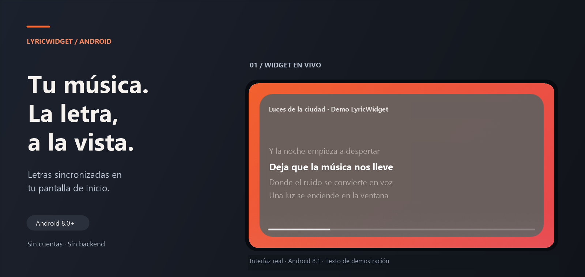
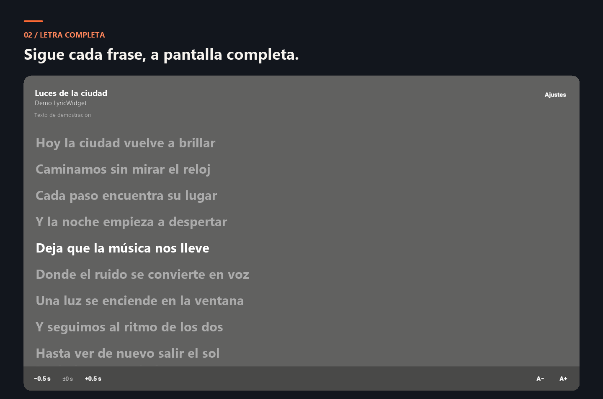
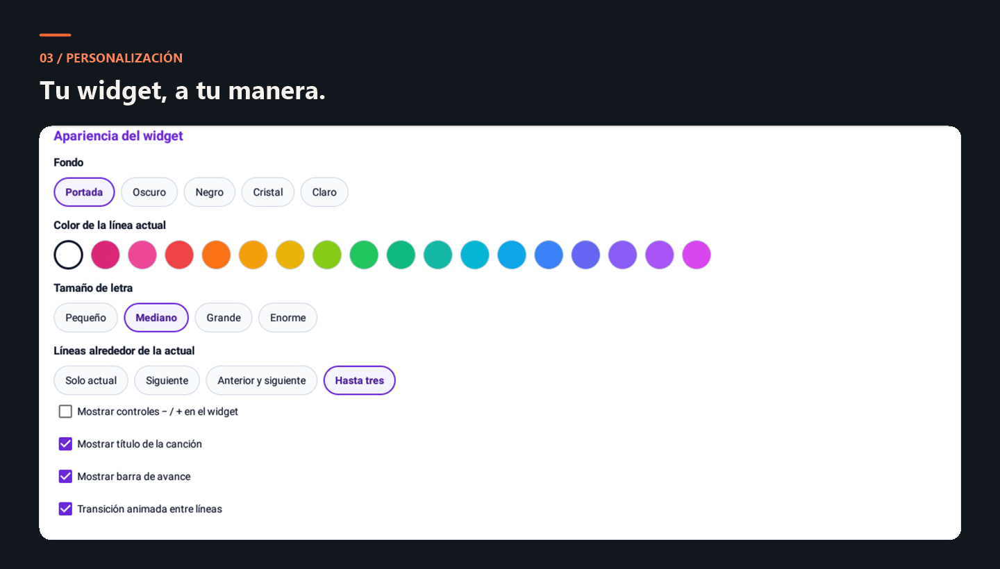

<p align="center">
  
</p>

<h1 align="center">LyricWidget</h1>

<p align="center">
  <b>La letra de tu música, en tu pantalla de inicio.</b><br>
  Un widget Android con letras sincronizadas, vista completa y ajustes a tu medida.<br>
  Sin cuentas, sin backend propio y desde Android 8.0.
</p>

<p align="center">
  <a href="https://github.com/Bloodiewormer/widget-music-lirycs/releases/latest"></a>
  
  
  <a href="LICENSE"></a>
  
</p>

<p align="center">
  <a href="https://github.com/Bloodiewormer/widget-music-lirycs/releases/latest"><b>Descargar APK</b></a>
  &nbsp; · &nbsp;
  <a href="#instalación">Instalación</a>
  &nbsp; · &nbsp;
  <a href="#capturas">Capturas</a>
  &nbsp; · &nbsp;
  <a href="https://github.com/Bloodiewormer/widget-music-lirycs/issues">Reportar un problema</a>
</p>

<p align="center">
  
</p>

## Tu música, acompañada de su letra

Reproduce una canción en tu app habitual. LyricWidget detecta la sesión multimedia, busca la letra y resalta la frase que está sonando. Puedes seguirla desde el escritorio o tocar la letra del widget para abrir la vista completa.

Funciona con reproductores que publican su actividad mediante las sesiones multimedia de Android, como Spotify y YouTube Music. La detección depende de los metadatos que entregue cada reproductor; la disponibilidad y la sincronización de las letras dependen de las fuentes.

| Función | Qué puedes hacer |
| --- | --- |
| **Widget en vivo** | Ver la frase actual y hasta tres líneas de contexto en un widget redimensionable. |
| **Letra completa** | Seguir la canción con la línea activa resaltada, cambiar el tamaño del texto y tocar una frase sincronizada para saltar a ese momento. |
| **Apariencia personalizable** | Elegir fondo, color y tamaño de letra; mostrar u ocultar título, barra de avance y controles de desfase. |
| **Sincronización ajustable** | Corregir el desfase en pasos de 0,5 s, guardar el ajuste por canción y aprovechar el aprendizaje de ajustes según reproductor y salida de audio. |
| **Búsqueda manual** | Corregir artista o título y vincular el resultado adecuado cuando la búsqueda automática no acierta. |
| **Caché local** | Reutilizar letras guardadas sin volver a descargarlas. Hace falta conexión para buscar letras nuevas. |
| **Selección de reproductores** | Elegir qué apps escuchar y priorizar la sesión que está reproduciendo música. |
| **Reloj en reposo** | Mostrar la hora cuando no hay música o tras dos minutos de pausa. |

## Capturas

Capturas de LyricWidget en una **Lenovo TB-X304F con Android 8.1**, recortadas y enmarcadas para destacar la interfaz. El widget y la vista completa usan **texto original de demostración**; la captura de personalización muestra los ajustes reales.

### Letra completa

La frase activa se mantiene a la vista. Los controles inferiores permiten ajustar la sincronización y el tamaño del texto.

<p align="center">
  
</p>

### Un widget a tu medida

Fondos inspirados en la portada, opciones claras y oscuras, paleta de acentos y controles de visibilidad. También puedes desactivar las transiciones entre líneas.

<p align="center">
  
</p>

## Instalación

1. **Descarga** el archivo APK desde [Releases](https://github.com/Bloodiewormer/widget-music-lirycs/releases/latest), en el apartado **Assets**.
2. **Instala** el APK. Si Android lo solicita, permite a tu navegador o gestor de archivos instalar aplicaciones.
3. **Abre LyricWidget** y concede el acceso a notificaciones desde el botón de la app. Android lo requiere para consultar las sesiones multimedia de otros reproductores.
4. **Añade el widget**: mantén pulsado un espacio vacío de la pantalla de inicio → **Widgets** → **LyricWidget**.
5. **Reproduce una canción** en una app compatible. Toca la letra del widget para verla completa o el título para abrir el reproductor.

> **Android 13 o superior:** si el sistema bloquea el acceso a notificaciones por tratarse de una instalación mediante APK, abre la información de LyricWidget, permite los ajustes restringidos y vuelve a conceder el acceso.

## Pensada para distintos dispositivos

| Plataforma | Comportamiento |
| --- | --- |
| **Android 8.0 y 8.1** | Distribución ligera y deslizamiento suave entre frases en el widget. |
| **Android 9 o superior** | Transiciones con fundido y adaptación del texto al espacio disponible cuando el dispositivo no utiliza el modo ligero. |
| **Android 12 o superior** | Opciones adicionales de color del sistema y difuminado de portada en la vista de letra completa. |
| **Dispositivos con poca RAM** | Modo ligero para reducir el trabajo de presentación. |

## Datos y fuentes de letras

- **Sin servidor propio ni registro.** La app consulta directamente [LRCLIB](https://lrclib.net) y usa [lyrics.ovh](https://lyrics.ovh) como alternativa.
- **Consultas de canciones.** Para buscar una letra se envían a esas fuentes los datos necesarios de la canción, como artista, título y, cuando corresponde, duración o álbum.
- **Acceso a sesiones multimedia.** El servicio utiliza el permiso de acceso a notificaciones para detectar reproductores; no guarda el contenido de las notificaciones.
- **Almacenamiento local.** Las letras y los ajustes se guardan en el dispositivo. La caché puede borrarse desde la app.
- **Letras sincronizadas o texto.** Cuando la fuente ofrece marcas de tiempo, la letra sigue la reproducción; cuando solo ofrece texto, puede consultarse sin sincronización.

## Desarrollo

App monolítica escrita en **Kotlin**, con vistas nativas y `RemoteViews`. No incorpora bibliotecas de terceros como Retrofit, Gson o Glance: las peticiones HTTPS usan `HttpURLConnection` y los datos se guardan localmente.

### Compilar

Requisitos: **JDK 17**, Android SDK con **API 37** y acceso al SDK configurado en `local.properties` o en el entorno. El repositorio incluye el wrapper de Gradle.

```bash
git clone https://github.com/Bloodiewormer/widget-music-lirycs.git
cd widget-music-lirycs

# macOS / Linux
./gradlew assembleRelease

# Windows PowerShell
.\gradlew.bat assembleRelease
```

APK generado: `app/build/outputs/apk/release/app-release.apk`.

Para instalarlo en un dispositivo conectado por USB:

```bash
adb install -r app/build/outputs/apk/release/app-release.apk
```

### Código principal

| Archivo | Responsabilidad |
| --- | --- |
| [NowPlayingService.kt](app/src/main/java/com/lyricwidget/app/NowPlayingService.kt) | Detectar y seleccionar sesiones multimedia. |
| [NowPlaying.kt](app/src/main/java/com/lyricwidget/app/NowPlaying.kt) | Mantener el estado de reproducción y programar los cambios de frase. |
| [LyricsRepository.kt](app/src/main/java/com/lyricwidget/app/LyricsRepository.kt) | Consultar las fuentes y gestionar la caché. |
| [LyricsWidget.kt](app/src/main/java/com/lyricwidget/app/LyricsWidget.kt) | Dibujar y actualizar el widget. |
| [LyricsActivity.kt](app/src/main/java/com/lyricwidget/app/LyricsActivity.kt) | Mostrar la letra completa. |
| [WidgetTheme.kt](app/src/main/java/com/lyricwidget/app/WidgetTheme.kt) | Gestionar la apariencia del widget. |
| [Device.kt](app/src/main/java/com/lyricwidget/app/Device.kt) | Adaptar la presentación a la versión de Android y la memoria disponible. |

## Reportar un problema

Abre un [issue](https://github.com/Bloodiewormer/widget-music-lirycs/issues) e incluye la versión de LyricWidget, el modelo del dispositivo, la versión de Android y el reproductor utilizado. Para fallos de letras o sincronización, añade **canción, artista y minuto aproximado**; una captura o grabación ayuda a reproducirlo.

## Licencia

El código de LyricWidget se distribuye bajo la **licencia MIT**. Consulta [LICENSE](LICENSE) para leer el texto completo.
